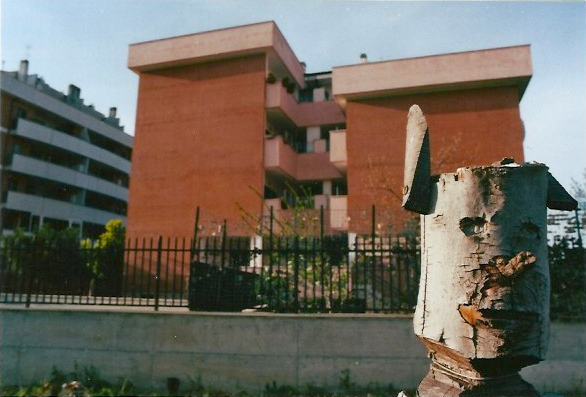

_con chiara, giacomo e anna_

  <iframe src="https://tubocatodico.bida.im/videos/embed/eN58szxTAayxz5uBgrTLgb"
          frameborder="0" 
          allow="accelerometer; autoplay; clipboard-write; encrypted-media; gyroscope; picture-in-picture; web-share" 
          allowfullscreen></iframe>

Con ARTICIVICHE 2015 (facoltà di architettura, universita roma tre) abbiamo esplorato assaggi del territorio di Primavalle, Casalotti e Monte Mario, ma poche sono state le _resistenze_ incontrate: molti cancelli, case dei Piani di Zona, gated community, quasi nessuno per strada. Eppure, lasciandoci una scuola di equitazione alle spalle siamo sbucati in un ex-terrain vague: i cittadini si sono appropriati di questo spazio, curandolo, portandoci giochi, fiori e un Pinocchio.

Il quartiere Selva Candida fa parte di un piano di zona, nuovi pezzi di città che costituiscono e alimentano l’estesa periferia romana; nati per adeguare lo strumento urbanistico alle varie caratteristiche del luogo, spesso diventano speculazione, lasciando gli spazi pubblici non ultimati, portando alla creazione di quartieri dormitorio.

Qui l’azione dei cittadini è fondamentale: usare spazi destinati ad essere pubblici ma mai conformati, creare comunità, conoscere il vicino, amare il territorio.

FUTURO PONDERANO nasce nel 2012 proprio dal bisogno di occuparsi della manutenzione degli spazi aperti del quartiere. “Quello che il comune non è stato capace di fare lo fanno i cittadini” scrive un cittadino sulla pagina facebook ufficiale.

Il 27 aprile 2014 in occasione del “la giornata della bellezza” il comitato in collaborazione di Legambiente installò _Pinocchio_ una scultura lignea che custodisce il parco e gli alberi da poco piantati.

La mia è un’azione discreta, semplice, non permanente e come tutte le fiabe tenta di avere una morale: accanto ad un _verde_ generato dal rispetto degli standard urbanistici, opero su un’architettura kitsch di servizio. Cito _il paese dei balocchi_ per rivolgermi ad una città con molte aspettative, spesso non esaudite ma con una consapevolezza crescente dell'importanza dei beni comuni.

>“Questo paese non somigliava a nessun altro paese del mondo. La sua popolazione era tutta composta di ragazzi. I più vecchi avevano quattordici anni: i più giovani ne avevano otto appena. Nelle strade, un’allegria, un chiasso, uno strillìo da levar di cervello! Branchi di monelli dappertutto: chi giocava alle noci, chi alle piastrelle, chi alla palla, chi andava in velocipede, chi sopra a un cavallino di legno: questi facevano a mosca-cieca, quegli altri si rincorrevano: altri, vestiti da pagliacci, mangiavano la stoppa accesa: chi recitava, chi cantava, chi faceva i salti mortali, chi si divertiva a camminare colle mani in terra e colle gambe in aria: chi mandava il cerchio, chi passeggiava vestito da generale coll'elmo di foglio e lo squadrone di cartapesta: chi rideva, chi urlava, chi chiamava, chi batteva le mani, chi fischiava, chi rifaceva il verso alla gallina quando ha fatto l'ovo: insomma un tal pandemonio, un tal passeraio, un tal baccano indiavolato, da doversi mettere il cotone negli orecchi per non rimanere assorditi. Su tutte le piazze si vedevano teatrini di tela, affollati di ragazzi dalla mattina alla sera, e su tutti i muri delle case si leggevano scritte col carbone delle bellissime cose come queste: Viva i balocci! (invece di balocchi): non voliamo più schole (invece di non vogliamo più scuole): abbasso Larin Metica (invece di l'aritmetica) e altri fiori consimili.”_

_Le avventure di Pinocchio. Storia di un burattino - C. Collodi_
