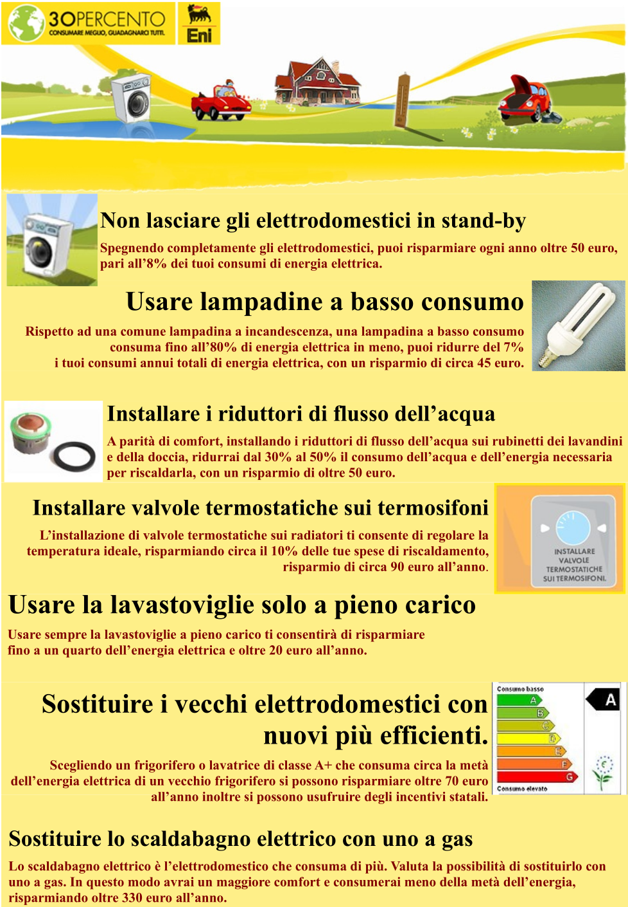
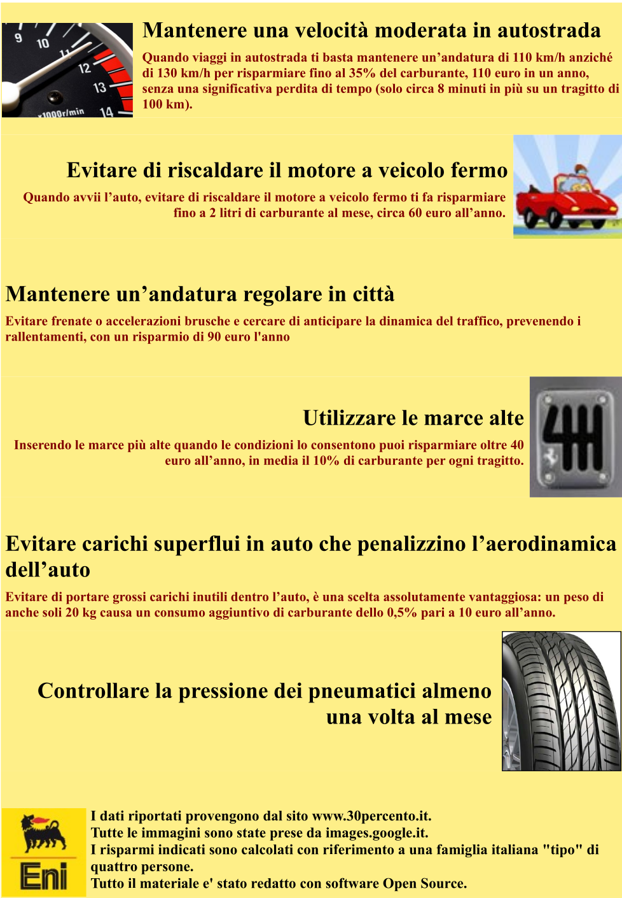

Del tema “ambiente” sentiamo quotidianamente parlare, in varie sedi e con varie argomentazioni, addirittura anche sfruttato nelle campagne elettorali. Ora, non pretendo di trovare soluzioni futuribili e improbabili nel campo energetico come per esempio l'utilizzo dell'idrogeno o i costosi impianti fotovoltaici; nemmeno di tornare al passato con proposte come la realizzazione di centrali nucleari praticamente impossibili da attuare in questa nazione caratterizzata o da un altissima densità di popolazione, o da regioni tettonicamente instabili e quindi spesso colpite da terremoti.

Semplicemente mi sono posto l'obbiettivo di comprendere come si è arrivati a questa situazione, cosa si e' fatto all'ambiente e in che modo, in aggiunta propongo alcune azioni da seguire per ridurre lo spreco di energia.

