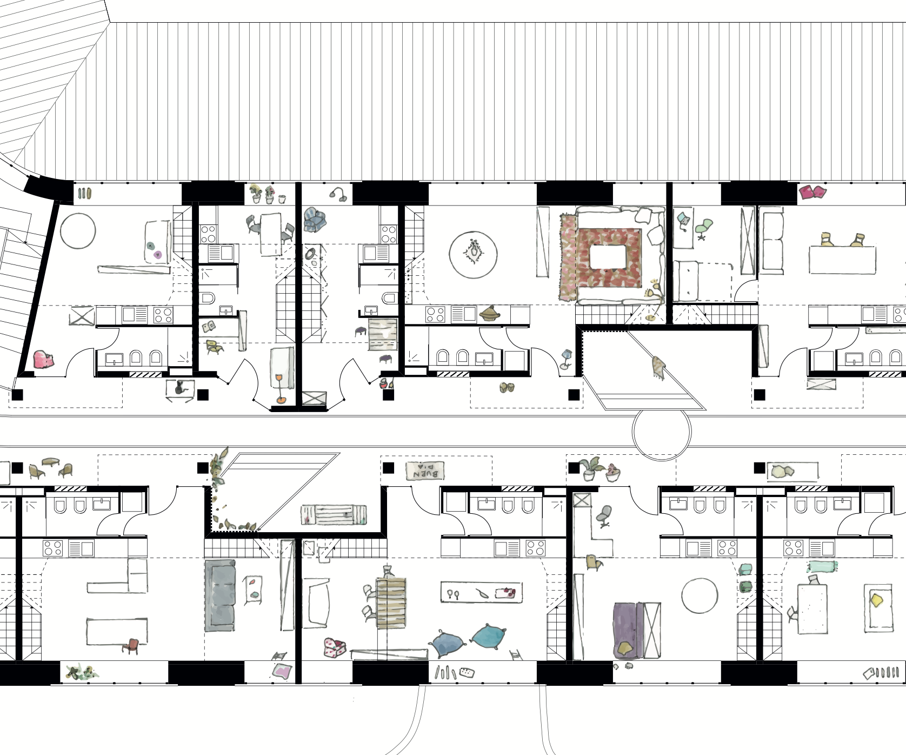

# progetto sperimentale di recupero dell’ex magazzino dell'areonautica militare in via del porto fluviale

 
_data della tesi: 2017-07-27_ 
_con chiara luchetti_ 
_relatori francesco careri, fabrizio finucci_ 
_università degli studi roma tre_

L’esercizio di tesi è stato svolto quasi interamente nel luogo di progetto dal gennaio 2017. Osservando e sostenendo un processo in atto da 14 anni, proponiamo uno studio di fattibilità per il recupero a scopo abitativo di un edificio storico sottoposto a vincolo dalla sovrintendenza.

Il progetto avvalora uno spazio dell’ abitare già consolidato, meticcio e autogestito. Un sistema che si compone di spazi collettivi e di case.

Proponiamo, agli abitanti attuali e futuri, un’ infrastruttura appropriabile dagli svariati usi e culture che hanno abitato questo luogo, e che incoraggi la grande abilità di trasformazione e intuizione spaziale che questi hanno avuto modo di dimostrarci.

[portofluviale.wordpress.com](portofluviale.wordpress.com)



  <iframe src="https://www.youtube.com/embed/pvfeKZlSK2E" 
          frameborder="0" 
          allow="accelerometer; autoplay; clipboard-write; encrypted-media; gyroscope; picture-in-picture; web-share" 
          allowfullscreen></iframe>

